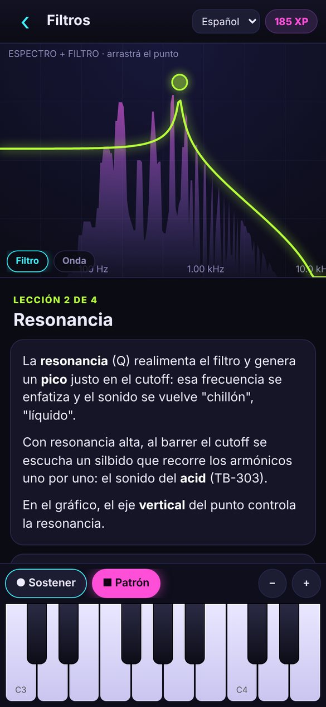
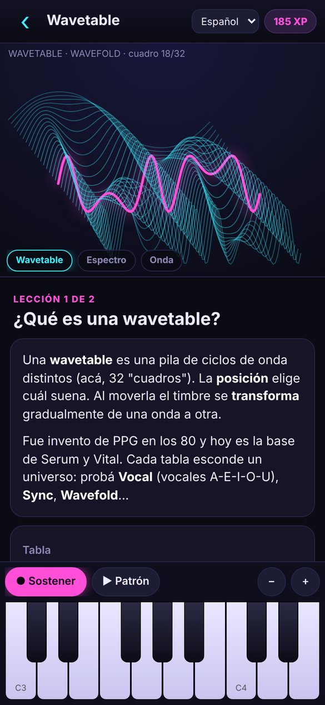
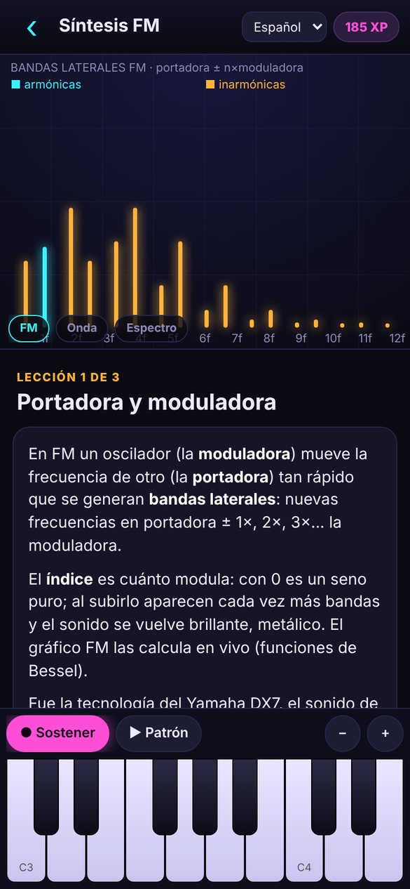
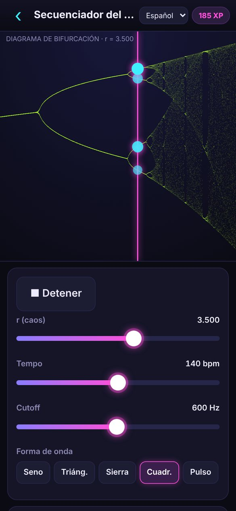

<p align="center">
  
  
  
  
</p>

<h1 align="center">SynthLab</h1>
<p align="center"><b>Aprendé síntesis de sonido viendo y escuchando.</b><br>
App para Android y para el navegador · código abierto · sin dependencias</p>

<p align="center">
  <a href="https://buenosairesfront.github.io/SynthLab/"><b>🌐 Landing page</b></a> ·
  <a href="https://buenosairesfront.github.io/SynthLab/app/"><b>▶ Probar en el navegador</b></a> ·
  <a href="https://github.com/buenosairesfront/SynthLab/raw/main/docs/SynthLab.apk"><b>⬇ Descargar APK</b></a>
</p>

---

SynthLab enseña síntesis con un sintetizador de verdad y gráficos en vivo: cada vez que movés un parámetro, **ves** lo que **escuchás**. Tiene osciloscopio, espectro, la curva del filtro (que se arrastra con el dedo), un ADSR editable con la nota corriendo, la wavetable en 3D y las bandas laterales de FM calculadas en tiempo real.

## ✨ Qué tiene

| Sección | Contenido |
|---|---|
| **Aprender** | 24 lecciones en 9 módulos, con tareas que se marcan solas cuando las cumplís ("hacé un pluck", "hacé una campana"). |
| **Recetas** | 10 sonidos clásicos paso a paso: bajo ácido 303, pad, pluck, supersaw, Reese, campana FM, bombo, redoblante/hi-hat, growl wavetable, e-piano FM. |
| **Tocar** | Sintetizador completo y secuenciador de 16 pasos con escalas y presets. |
| **Lab** | Cuerda física (Karplus-Strong), Lissajous y ring mod, secuenciador del caos (mapa logístico), "dibujá tu onda" (Fourier), pad XY tipo Kaoss, Destructor (saturación/bitcrush). |
| **Retos** | Entrenamiento de oído: 19 tipos de preguntas y 5 desafíos de "igualá el sonido". Puntos XP y mejores puntajes. |

### Temario

1. **Fundamentos del sonido**: frecuencia, octavas, timbre, armónicos
2. **Osciladores**: formas de onda, pulso/PWM, detune, unison, ruido
3. **Filtros**: low-pass, resonancia, HP/BP/notch, pendiente, keytracking
4. **Envolventes**: ADSR de amplitud, de filtro y de pitch
5. **LFO y modulación**: vibrato, trémolo, wah, S&H, LFO a audio
6. **Síntesis aditiva**: dibujar armónicos, Fourier en acción
7. **Síntesis FM**: portadora/moduladora, ratios, índice, e-piano
8. **Wavetable**: tablas, posición, escaneo con LFO
9. **Efectos**: saturación, bitcrush, delay, reverb

### El motor de síntesis

Polifónico (14 voces), sobre Web Audio API:

- 2 osciladores (seno, triángulo, sierra, cuadrada, pulso con PW, wavetable, aditiva) + ruido
- Unison de hasta 7 voces con apertura estéreo
- Filtro LP/HP/BP/Notch de 12 o 24 dB/oct, resonancia y keytracking
- Dos ADSR (amplitud y filtro) + envolvente de pitch
- LFO (seno, triángulo, cuadrada, sierra, S&H) hacia pitch, cutoff, volumen, paneo o wavetable
- FM con ratio, índice y envolvente de índice
- 7 wavetables generadas por síntesis de Fourier (Básica, Pulso, Vocal, Sync, Wavefold, Espectral, Digital)
- Saturación, bitcrush, delay con feedback y reverb por convolución
- Modo mono con glide

## 📱 Instalar en Android

1. Desde el celular, descargá [`SynthLab.apk`](https://github.com/buenosairesfront/SynthLab/raw/main/docs/SynthLab.apk) (descarga directa desde GitHub).
2. Abrilo desde la notificación de descarga o desde **Archivos → Descargas**.
3. Si Android lo pide, permití **instalar apps de esta fuente**.
4. Tocá **Instalar**. Si aparece Play Protect: **Más detalles → Instalar de todas formas** (sale porque la app no viene de la Play Store).

Requiere Android 7.0 o superior. Funciona sin internet.

## 🗂 Estructura del repositorio

```
web/              La app (HTML + JS puro). Es la misma para Android y navegador.
  index.html      Shell y estilos
  js/engine.js    Motor de audio: voces, filtros, envolventes, LFO, FM, wavetables, efectos
  js/ui.js        Controles, teclado multitáctil y visualizaciones en Canvas
  js/content.js   Lecciones, recetas y generadores de retos de oído
  js/lab.js       Experimentos del laboratorio
  js/app.js       Navegación, pantallas, progreso (localStorage)
android/          Envoltorio nativo: una Activity con WebView que carga web/
site/             Landing page + capturas
docs/             Sitio armado para GitHub Pages (generado por scripts/build-site.sh)
scripts/          Compilación del APK y del sitio
```

## 🛠 Desarrollo

**Correr la versión web:** abrí `web/index.html` en el navegador, o levantá un servidor:

```bash
npx serve web        # o: python3 -m http.server -d web
```

**Compilar el APK** (no hace falta Android Studio ni el SDK de Android):

```bash
./scripts/build-apk.sh      # → dist/SynthLab.apk
```

Necesita Java 17+, Node/npm, Python 3, `curl` y `zip`. La primera vez descarga el toolchain en `.tools/`: `aapt2` (paquete npm `aaptjs3`), `android.jar` (Robolectric `android-all`), `dx` y `apksig` (Maven Central).

> **Firma:** el script firma con `keys/release.p12` (si no existe, lo crea). Ese archivo **no** se sube a git. Guardalo bien: para que una versión nueva se instale encima de la anterior, tiene que estar firmada con la misma clave. Podés usar otra clave con `SYNTHLAB_KEYSTORE=/ruta/clave.p12 SYNTHLAB_KS_PASS=... ./scripts/build-apk.sh`.

**Armar el sitio** (landing + app web + APK) en `docs/`:

```bash
./scripts/build-apk.sh && ./scripts/build-site.sh
```

## 🌐 Publicar la landing en GitHub Pages

1. Subí el repo a GitHub (por ejemplo, con el nombre `SynthLab`).
2. Andá a **Settings → Pages**.
3. En **Source** elegí **GitHub Actions**. El workflow `.github/workflows/pages.yml` publica la carpeta `docs/` en cada push a `main` (también se puede correr a mano desde la pestaña **Actions**).
4. En uno o dos minutos queda online en `https://buenosairesfront.github.io/SynthLab/`:
   - `/` → landing page
   - `/app/` → la app en el navegador
   - `/SynthLab.apk` → descarga directa


## 📄 Licencia

[MIT](LICENSE)
